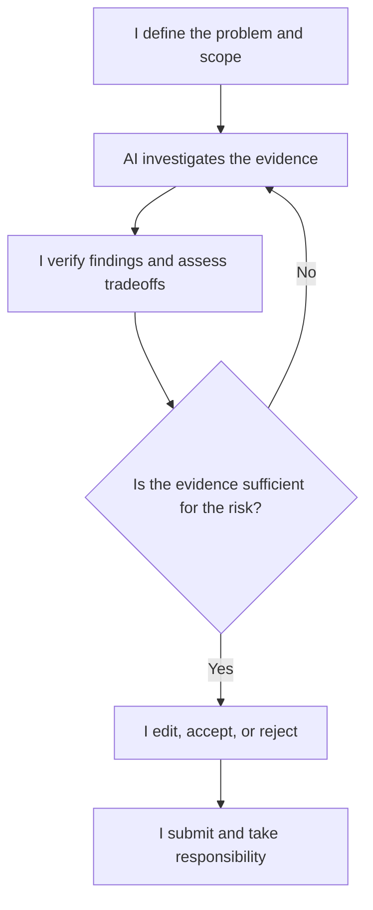

# My Human: A Manifesto for Accountable AI-Assisted Engineering

I believe AI should amplify human judgment, not replace human responsibility.

My goal in using AI for engineering is not to hand over decisions. It is to increase the speed, depth, and reach of my analysis while keeping accountability with me.

## My working model

- **I decide what matters.** I define the problem, set the scope, identify the risks, and decide what deserves investigation.
- **AI investigates.** It analyzes logs, diffs, traces, source code, documentation, release notes, tests, and system behavior. It searches for patterns, proposes explanations, compares alternatives, and exposes possibilities I may otherwise miss.
- **I verify.** I treat AI outputs as hypotheses, not authority. I check claims against evidence, review code, run tests, challenge assumptions, and look for failure modes.
- **I decide.** I accept, modify, or reject the AI’s conclusions. A recommendation does not become a decision simply because a model produced it.
- **I take responsibility.** When I submit code, merge a patch, maintain a package, publish an analysis, or make a technical claim, I stand behind it.

That responsibility cannot be delegated to a model.

## My principles

### AI may generate. I must understand.

I submit generated code only when I understand what it does, why it works, and what could make it fail. In a language, framework, or system I do not yet understand, AI helps me explore and learn. I do not treat its output as production-ready until I can meet that standard.

### AI may recommend. I decide.

Models can expose tradeoffs and suggest actions. They do not own the consequences.

### AI can accelerate verification. It does not replace it.

Speed is valuable. Unverified output is not. AI-assisted work must meet the same standards I expect from any serious engineering work: correctness, security, maintainability, testing, reproducibility, and reviewability.

I match the depth of verification to the risks and consequences of the change.

### Responsibility follows submission, not authorship.

The important question is not “Who typed these tokens?” It is “Did I verify them, understand them, and am I willing to stand behind them?”

### I disclose AI assistance by default.

In shared or published work, I disclose AI assistance by default. I treat non-disclosure as a deliberate exception I can justify, not a decision made after the fact.

### Automation should reduce work, not transfer it.

I do not use AI to create speculative code, reviews, comments, or issues that simply move the verification burden onto someone else.

### Verification failures are mine to address.

If the AI is wrong and I miss it, I own that verification failure. I investigate why my process missed it and improve the process. I do not use the model as an excuse.

### Human judgment remains the final control plane.

AI can inspect a system, reason about it, and propose changes. I decide whether those changes enter the system.

## The workflow

Copyright © 2026 FT_IOxCS (@ft-ioxcs)
